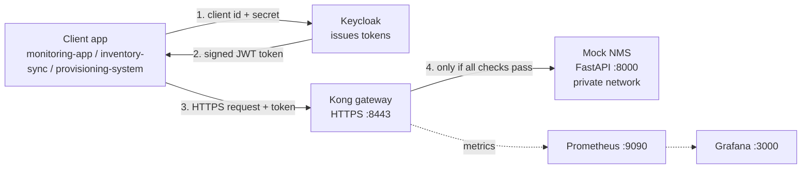

# Secure API Gateway for NMS Northbound Interfaces

A network management system (NMS) exposes a **northbound API** so other systems can read alarms, devices and performance data, or push configuration. If anyone could call it freely, that would be dangerous.

This project puts a **security gateway (Kong)** in front of a mock NMS. The gateway checks *who you are*, *what you may do*, *how often you call*, and *how you connect* before any request reaches the backend. A Grafana dashboard shows what was allowed and what was blocked.

## Architecture



Plain-text version:

```
                 1. id + secret
   Client app  ------------------->  Keycloak (identity provider)
       |       <-------------------  2. signed token (JWT)
       |
       | 3. HTTPS request + token
       v
   +------------------ Kong gateway (:8443) -------------------+
   |  HTTPS only -> IP check -> token check -> size limit ->    |
   |  rate limit -> scope check -> allowed method/route         |
   +-----------------------------+------------------+-----------+
                                 | 4. if all pass   | metrics
                                 v                  v
                   Mock NMS (FastAPI)          Prometheus -> Grafana
                   private network only        (allowed vs blocked)
```

## What each piece does

| Piece | Plain-English role |
|---|---|
| **Mock NMS (FastAPI)** | The fake network manager with `/alarms`, `/devices`, `/performance`, `/config`. It has no security of its own. |
| **Keycloak** | The ID office. A client logs in with its ID and secret and gets a signed token (JWT) that lists what it may do. |
| **Kong (DB-less)** | The security guard. Its whole configuration is one file (`kong/kong.yml`), no database. |
| **JWT token** | A signed pass. Kong checks the signature with Keycloak's public key, so forged or edited tokens fail. |
| **Scope** | A permission written in the token, for example `alarms:read`. |
| **Prometheus** | Collects counters from Kong (requests by status code and by client). |
| **Grafana** | Draws those counters as the allowed-vs-blocked dashboard. |
| **Demo portal** | A small web page with buttons to try every case, plus the attack demos. |

## The three clients

| Client | Allowed scope | Endpoint | Rate limit |
|---|---|---|---|
| `monitoring-app` | `alarms:read`, `performance:read` | `GET /alarms`, `GET /performance` | 20 / minute |
| `inventory-sync` | `devices:read` | `GET /devices` | 10 / minute |
| `provisioning-system` | `config:write` | `PUT /config` | 3 / minute, and only from allowed IPs |

The limits are my interpretation of the project brief; change them in `kong/kong.yml.tpl`.

## What the gateway enforces

| Situation | Result |
|---|---|
| No token, or a bad/expired/forged token | **401** Unauthorized |
| Valid token but wrong scope (e.g. monitoring-app calls `/devices`) | **403** Forbidden |
| Too many requests in a minute | **429** Too Many Requests |
| Valid token, right scope | **200** OK |
| Plain HTTP instead of HTTPS | **426** Upgrade Required |
| Body larger than 10 KB | **413** Payload Too Large |
| `/config` called from a disallowed IP (allowed: `172.16.0.0/12`) | **403** |
| Method not listed on a route (e.g. `DELETE /alarms`) | **404** (no route matches) |
| Trying to reach the backend directly | Not possible: it has no published port and sits on a network only Kong shares |

How it is built (details):
- **Token check:** Kong's `jwt` plugin. Each client is a Kong *consumer*, matched by the token's `azp` (client id) claim, so limits are per client.
- **Scope check:** Kong OSS has no scope check in its JWT plugin, so a small Lua `post-function` on each route reads the `scope` claim (the signature was already verified).
- **Rate limit:** the built-in `rate-limiting` plugin, a **fixed window per clock minute**, counters kept in each Kong node's memory (`policy: local`).

## Project files

| File | What it is |
|---|---|
| `docker-compose.yml` | Starts all containers (all image versions pinned). |
| `.env` / `.env.example` | Secrets (`.env` is gitignored; copy the example and change the values). |
| `backend/` | The FastAPI mock NMS and its Dockerfile. |
| `keycloak/nms-realm.json` | Realm `nms` with the three clients and their scopes; imported at startup. Client secrets come from `.env`. |
| `kong/kong.yml.tpl` | Kong's declarative config template: routes, scope checks, consumers, plugins. |
| `kong/kong.yml` | Generated from the template (gitignored); it contains Keycloak's public key. |
| `scripts/up.sh` | One command to start everything. |
| `scripts/gen_cert.sh` | Makes the self-signed TLS certificate in `certs/` (gitignored). |
| `scripts/gen_kong_config.py` | Fetches Keycloak's public key and renders `kong/kong.yml`. |
| `scripts/attack_demo.py` | Runs the attack demos in the terminal. |
| `prometheus/`, `grafana/` | Scrape config, data source and the provisioned dashboard. |
| `demo/portal.py`, `demo/index.html` | The click-through demo portal. |
| `demo/attacks.py` | The attack demos (shared by tests, script and portal). |
| `tests/` | Automated pytest tests. |

## How to use it

**You need:** Docker with Docker Compose, Python 3.11+, and Git Bash (on Windows) or any Linux/macOS shell.

### 1. Set up and start
```bash
cp .env.example .env            # then edit .env and set real passwords/secrets
./scripts/up.sh                 # builds, starts everything, waits until ready

python -m venv .venv
.venv/Scripts/pip install -r tests/requirements.txt      # Linux/macOS: .venv/bin/pip
```
`up.sh` creates the certificate, starts Keycloak and the backend, generates `kong.yml` from Keycloak's key, then starts Kong, Prometheus and Grafana.

### 2. Where to look
| What | Address |
|---|---|
| Gateway (HTTPS) | https://localhost:8443 (self-signed cert, so the browser warns once) |
| Demo portal | http://localhost:9000 (start with `.venv/Scripts/python demo/portal.py`) |
| Grafana dashboard | http://localhost:3000, dashboard **NMS Gateway: allowed vs blocked** (view-only without login; admin password is `GRAFANA_ADMIN_PASSWORD` in `.env`) |
| Prometheus | http://localhost:9090, then **Status > Targets** to see Kong being scraped |
| Keycloak admin | http://localhost:8080 (user and password from `.env`) |

A browser cannot attach a token by itself, so visiting `https://localhost:8443/alarms` shows the 401. Use the demo portal for the other cases.

### 3. Try it with curl
```bash
set -a; . ./.env; set +a

# get a token for monitoring-app
TOKEN=$(curl -s localhost:8080/realms/nms/protocol/openid-connect/token \
  -d grant_type=client_credentials -d client_id=monitoring-app \
  -d client_secret=$MONITORING_APP_SECRET | python -c "import sys,json;print(json.load(sys.stdin)['access_token'])")

curl -sk -i https://localhost:8443/alarms                                  # 401 no token
curl -sk -i https://localhost:8443/alarms  -H "Authorization: Bearer $TOKEN"   # 200
curl -sk -i https://localhost:8443/devices -H "Authorization: Bearer $TOKEN"   # 403 wrong scope
```
`-k` skips the self-signed certificate check. Tokens last 5 minutes.

### 4. Run the tests
```bash
.venv/Scripts/python -m pytest tests -v       # 30 tests, about 2 minutes
.venv/Scripts/python scripts/attack_demo.py   # the 10 attack demos only
```
The tests take about two minutes because rate-limit windows reset each clock minute, so the 429 test waits for a fresh minute. They need the stack running. Covered: 200, 401, 403, 429, HTTPS-only, size limit, IP restriction, method allow-list, and the attacks below.

### 5. Attack demos
Each of these is blocked:

| Attack | Result |
|---|---|
| Tampered token signature | 401 |
| Payload edited to add the `config:write` scope | 401 |
| Valid-looking token signed with the attacker's own key | 401 |
| `alg=none` (unsigned) token | 401 |
| HS256 key-confusion (public key used as the HMAC secret) | 401 |
| Genuinely expired token | 401 |
| 20 KB oversized payload | 413 |
| Plain HTTP downgrade | 426 |
| Backend `/docs` and `/openapi.json` via the gateway | 404 |
| Direct-to-backend bypass | unreachable |

Run them from the portal (**Run all attack demos**) or the terminal script. The expired-token demo briefly sets the Keycloak realm token lifetime to 1 second through the admin API and restores it to 300.

### 6. Suggested demo order (about 10 minutes)
1. Show the architecture diagram above.
2. In the portal, show 401 (no token), 200 (right client), 403 (wrong scope).
3. Click the "send x4" button to show 429.
4. Click the oversize and disallowed-IP buttons (413, 403).
5. Run the attack demos.
6. Open Grafana and show the allowed vs blocked counters filling in.
7. Run `pytest` and show it all green.

### 7. Stop
```bash
docker compose down
```

## Limits to know about
- Self-signed certificate and Keycloak in dev mode: fine for a demo, not for production.
- Rate-limit counters are per Kong node and use fixed windows, so a client can burst across a minute boundary. Several Kong nodes would need `policy: redis`.
- The IP restriction trusts `X-Forwarded-For` from the Docker network so the blocked-IP case can be demonstrated. In production, trust only your real proxy.
- Rate-limit counters reset each clock minute, so after running the tests wait for the next minute before demoing a 429.
